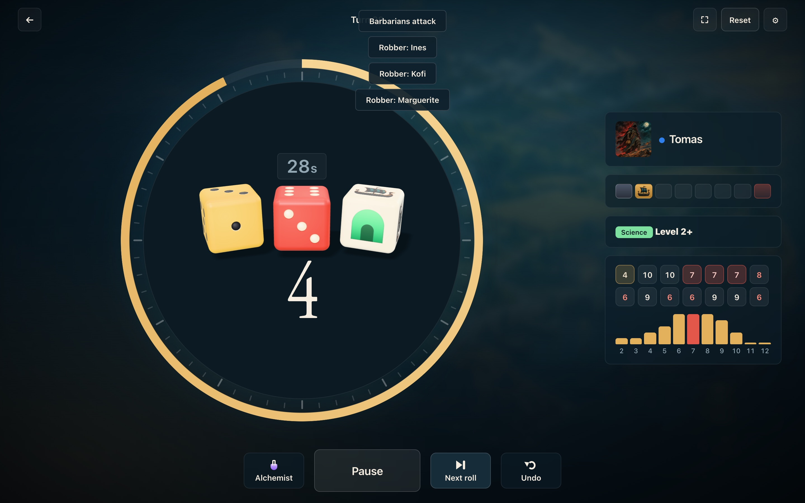
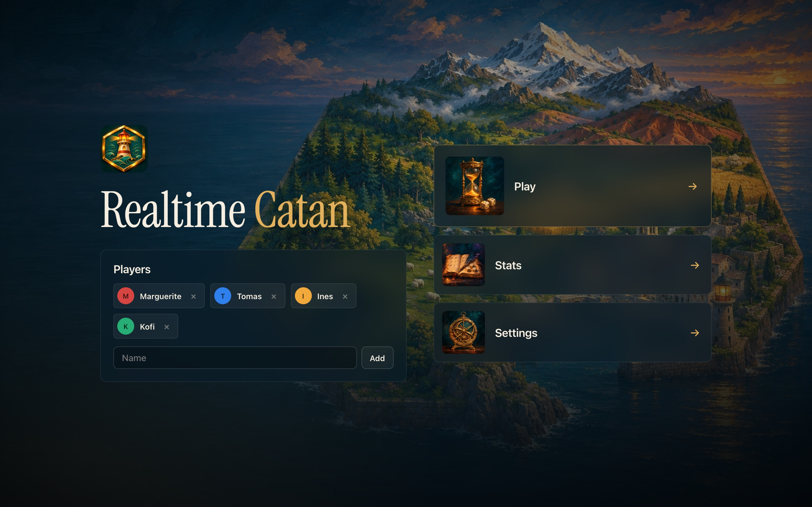
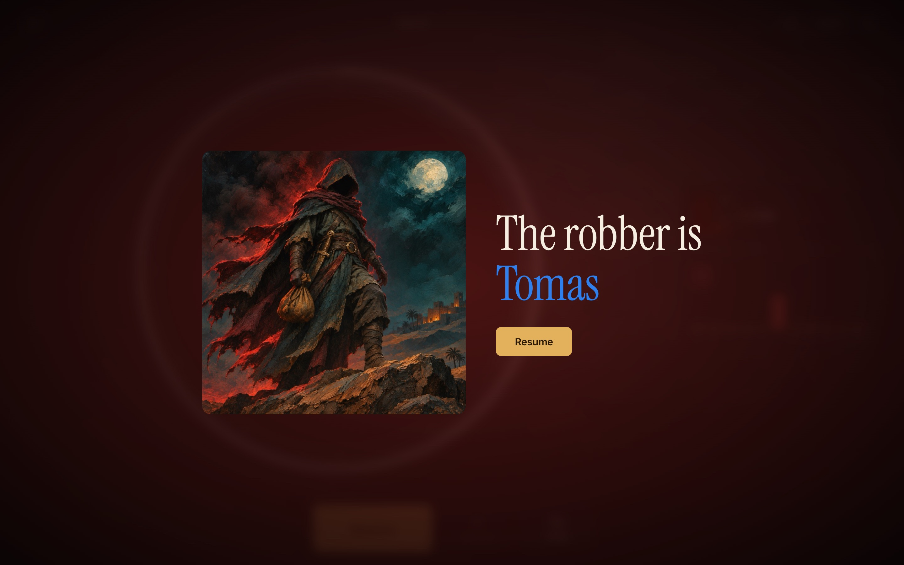
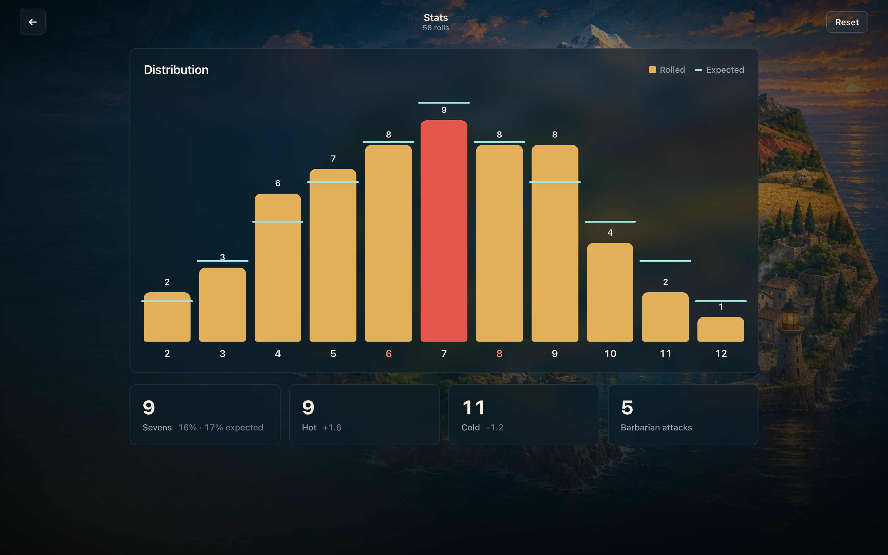
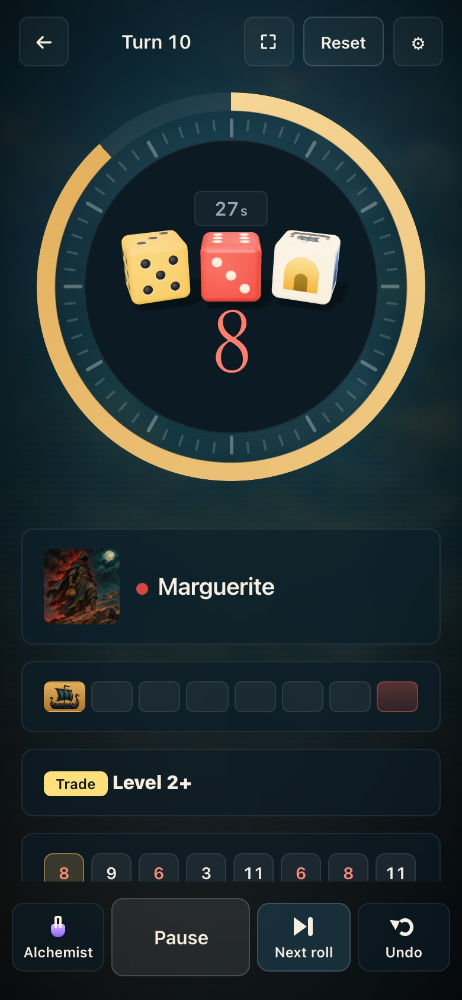

# Realtime Catan — dice companion

A companion screen for playing [Real-Time Settlers](https://robert.ocallahan.org/2024/06/real-time-settlers.html) on a physical board.
Put it in the middle of the table: a shared clock rolls the dice for everyone every 30 seconds.

**Live:** https://realtime-catan.vercel.app



<table>
  <tr>
    <td width="50%"></td>
    <td width="50%"></td>
  </tr>
  <tr>
    <td width="50%"></td>
    <td width="50%" align="center"></td>
  </tr>
</table>

## Features

- **Play**: an auto-rolling clock with Start/Pause/Resume, **Next roll** and **Reset**.
- **Auto-pause on 7**: the clock stops and the screen names who moves the robber. The robber passes around the table in seat order, starting with the first player.
- **Cities & Knights**: yellow, red and event dice, a barbarian ship track, attack alerts, progress-card gate thresholds, the **Alchemist** (the next turn waits for named dice) and the optional "robber waits for the first attack" rule.
- **Stats**: a dice histogram against the expected distribution, plus hot and cold numbers.
- **Settings**: a turn-length formula `f(t)` (for example `20 + t/2`), fair dice (a shuffled deck of all 36 outcomes), warning ticks, volume, spoken roll announcements, keeping the screen awake, and table colours.
- **Undo**: removes the last roll.
- **Saving**: everything is saved on the device (localStorage).

Keys: `Space` start/pause · `N` next roll · `P` pause · `A` alchemist · `F` fullscreen.

## Run locally

It's a static site with no build step and no dependencies.

```sh
cd public && python3 -m http.server 5173
# open http://localhost:5173
```

You can also open `public/index.html` directly in a browser.

## Deploy

The repo is connected to Vercel: every push to `main` deploys `public/` to https://realtime-catan.vercel.app.

## Development

The 3D dice (three.js) live in `public/dice3d.js` and ship pre-bundled as `public/dice3d.bundle.js`, so they work even when the page is opened from disk.
After editing `dice3d.js`, rebuild the bundle:

```sh
npx esbuild public/dice3d.js --bundle --format=iife --minify --target=es2020 \
  --alias:three=./public/vendor/three.module.min.js --loader:.png=dataurl \
  --outfile=public/dice3d.bundle.js
```

Then bump the `?v=` numbers in `index.html` so browsers fetch the new files.

Artwork in `public/assets/` was generated with ChatGPT image generation (via the Codex CLI).
